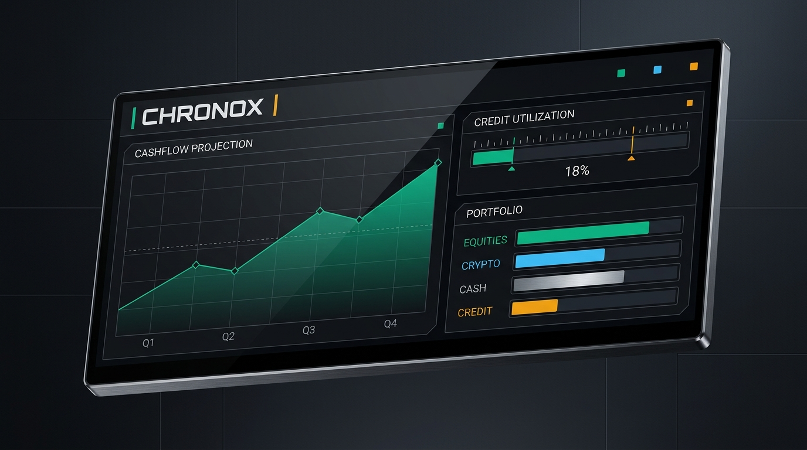

# ChronoX Finance

**A local-first, dark-industrial personal finance command center unifying exact-cent cashflow analytics, encrypted secret management, portfolio tracking, honest credit simulation, and verifiable AI coaching.**

[](https://github.com/Bit-Loop/CHronoX/actions/workflows/ci.yml)


[](LICENSE)

---

## Core Capabilities

| Pillar | What Ships Today |
| :--- | :--- |
| **Envelope Vault Security** | Mandatory launch password (`PBKDF2-HMAC-SHA256`, 600,000 iterations), random 32-byte DEK sealing `secrets.enc` (`AES-256-GCM`, `0600`), one-time Recovery Key (200-bit Base32), strict loopback `Host`/`Origin` DNS-rebinding defense, `SameSite=Strict` `HttpOnly` session cookies, per-boot CSRF header tokens, and zero-CDN CSP. |
| **Banking, Brokers & Email** | BYOK **Plaid Hosted Link** (`730-day` history, `/transactions/sync`, Liabilities, Investments), **SimpleFIN Bridge**, zero-3rd-party **Navy Federal CSV/PDF** + Desktop **Auto-Import Drop Folder**, read-only enforced **Coinbase** & **Robinhood Crypto** (key permissions verified on connect), optional BYOK **Schwab OAuth2**, and opt-in read-only IMAP (`BODY.PEEK`) email bill scanner. |
| **Analytics, Rules, Credit & Portfolio** | MoneyStill-inspired 3-column **Cashflow Sankey**, category Donut, 2-year Trend & draggable **What-If Timeline**; Firefly-style automation rules, exact-sum splits & min/max bill ranges; **Honest 5-Factor Credit Simulator** with optional BYOK **Credit Score APIs** (Spinwheel, Array, CRS Credit API, Custom HTTPS/local bridge), AnnualCreditReport PDF/manual imports, AZEO, Chase 5/24 & drop-off timelines; exact `10^-8` stock & crypto holdings. |
| **3-Mode Intelligence & Agentic Coach** | Switch live between **Quant Math** (`deterministic_only`, zero external calls), **Hybrid** (`hybrid`), and **AI Standalone** (`ai_standalone`) across **OpenCode Go**, **Google Gemini**, **OpenAI / Codex** (`store: false` stateless prompt caching), **Durable Chat Wrappers** (LiteLLM / OpenRouter / Ollama), and sandboxed local **Codex CLI** (`--sandbox read-only`) — with live **AI Usage / Cache Savings** tracking and atomic **Preview → Execute → Undo** actions (no money movement). |

### Security & Storage Transparency

- **Encrypted at rest (`secrets.enc`, `0600`)**: API keys, Plaid/SimpleFIN/broker credentials, and IMAP App Passwords are sealed with AES-256-GCM under a random 32-byte DEK wrapped by your vault password and one-time Recovery Key.
- **Unencrypted local ledger (`finance.sqlite3`, `0600`)**: Your SQLite ledger database is stored **unencrypted on disk** with owner-only `0600` file permissions (inside a `0700` directory) for fast local querying and safe pre-migration backups (`backups/pre-vN.db`). Use OS full-disk encryption (LUKS / BitLocker / FileVault) for disk-level ledger protection.
- **Auto-lock behavior**: Locking drops active DEK references and pauses background syncs until unlocked. Because Python cannot guarantee deterministic RAM zeroization of immutable buffers, ChronoX does not claim hardware-level memory wiping.

---

## Quick Start

### 1. Desktop App (Recommended)

Hardened Electron shell with an embedded PyInstaller backend sidecar, live System Tray Safe-to-Spend readout, and global Quick-Capture HUD (`Ctrl+Shift+Space` / `Cmd+Shift+Space`).

| Platform | Architectures | Setup / Build |
| :--- | :--- | :--- |
| **Linux (`.deb`, `.pacman`, `.AppImage`)** | `x86_64`, `aarch64` | `./scripts/install-linux.sh --dev --launch` (or `--deb` / `--pacman` / `--appimage` with `--with-backend`) |
| **Arch Linux (`PKGBUILD`)** | `x86_64`, `aarch64` | `cd desktop/packaging/arch && CHRONOX_LOCAL_REPO=1 makepkg -si` |
| **Windows (NSIS + Portable `.exe`)** | `x64`, `ARM64` | `.\scripts\install-windows.ps1 -Launch` (or `-BuildInstaller` for `.exe` packages) |
| **Makefile (Linux / macOS)** | `x64`, `arm64` | `make dev && make desktop-install && make desktop` |

See [`desktop/README.md`](desktop/README.md) and [`desktop/packaging/arch/README.md`](desktop/packaging/arch/README.md) for packaging, Wayland flags, and release details.

### 2. Web App & Terminal CLI

```bash
cp .env.example .env
make dev                                       # Create .venv (Python 3.12) & install deps
make finance                                   # Launch on http://127.0.0.1:8742

# Fast terminal workflow (no browser required)
.venv/bin/python main.py --action budget --quick "coffee 6.50"
.venv/bin/python main.py --action budget --portfolio
.venv/bin/python main.py --action budget --usage
.venv/bin/python main.py --action budget --mode deterministic_only --suggest
```

### 3. Docker & Quality Checks

```bash
docker compose up -d --build chronox-finance   # Bound strictly to 127.0.0.1:8742
make test && make lint                         # Full pytest suite + ruff lint & Bandit checks
```

---

## Architecture & Roadmap

ChronoX separates a deterministic exact-integer-cent Python engine (`chronox_finance/`) from a zero-CDN ES-module UI (`chronox_finance/web/`) and Electron shell (`desktop/`), alongside an optional algorithmic market core (`data/`, `models/`, `backtesting/`) gated by a hard **Safe-to-Invest** liquidity firewall.

- **Today**: Local-first desktop & loopback web app (`127.0.0.1`) powered by versioned **`/api/v1/*`** JSON contracts, idempotent SQLite migrations, and zero third-party telemetry.
- **Next**: Self-hosted web deployment and a native **SwiftUI iOS client** built directly against the same `/api/v1/*` API surface.

## License

MIT — see [`LICENSE`](LICENSE). Educational and personal finance tooling; not financial advice.
